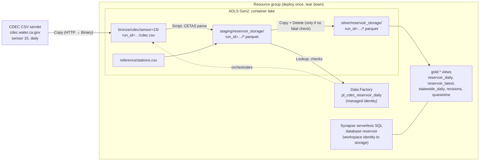
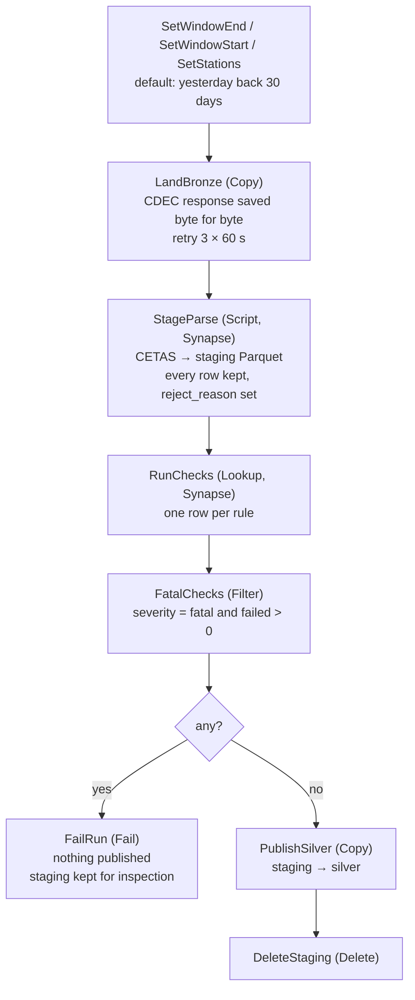
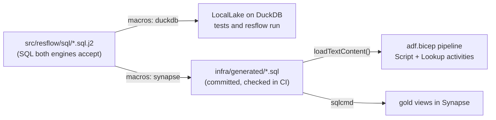
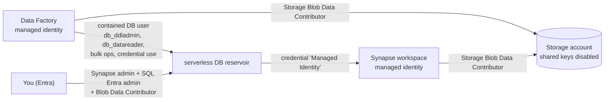

# Architecture

## Components

## One run, step by step

## Checks

| Rule | Severity | Fails when |
|---|---|---|
| F1_header | fatal | the response does not have exactly one header row with the 9 expected CDEC column names (this is what catches an HTML error page served with status 200) |
| F2_contract | fatal | a row has an unknown station, a sensor other than daily storage in AF, an unparseable date, or a date outside the requested window |
| F3_duplicate_keys | fatal | the same station and day appears twice in one response |
| F4_completeness | fatal | fewer station-days than stations × days in the window (CDEC returns a row for every day, with `---` when there is no reading, so a short file means a truncated response) |
| F5_window | fatal | the requested window ends before it starts |
| W1_missing_value | warning | count of `---` readings; kept as NULL, never filled |
| W2_estimated | warning | count of readings flagged `e` |
| W3_revised_flag | warning | count of readings flagged `r` |
| W4_rejected_row | warning | rows quarantined: not a number, negative, or above 120% of capacity |
| W5_unknown_flag | warning | a data flag other than `e` or `r` |

## Lake layout and history

* **bronze** is the raw response per run. It is never rewritten.
* **staging** holds one run's parsed Parquet until the checks pass. A run that fails a fatal check leaves its staging folder for inspection; gold never reads staging.
* **silver** is append-only, one folder per published run. Each run re-pulls a trailing 30-day window, because CDEC revises recent values, so the same station-day appears in many runs.
* **gold** is views, not tables. `reservoir_daily` picks, per station and day, the newest run that has a real value. A later run that returns `---` for a day does not erase an earlier reading. `revisions` lists every station-day where runs disagreed.

## Same SQL in two places

The macros cover the parts that differ: how files are read (`read_csv`/`read_parquet` versus `OPENROWSET`), date arithmetic (`date_diff` versus `DATEDIFF`), and `chr(13)` versus `CHAR(13)`. See [ADR 0002](adr/0002-one-sql-source-two-engines.md).

## Identity

No keys or passwords are stored anywhere. The SQL admin password ARM asks for is a random GUID that is never used, because the workspace is Entra-only.
